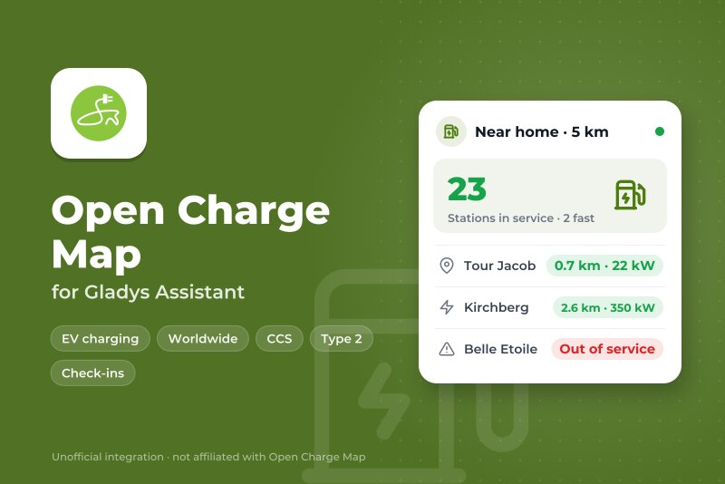
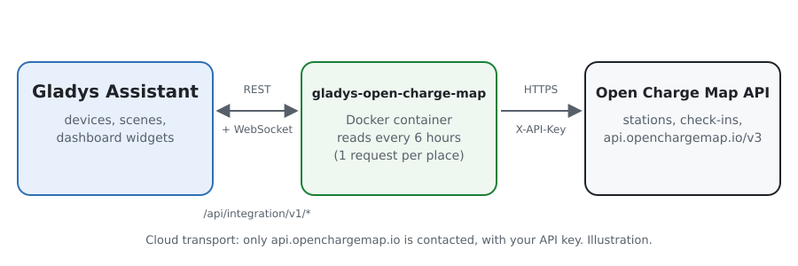
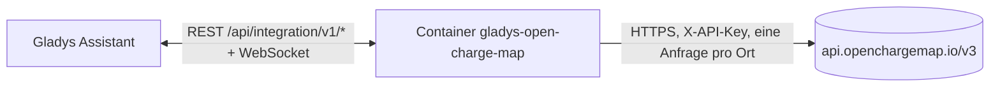
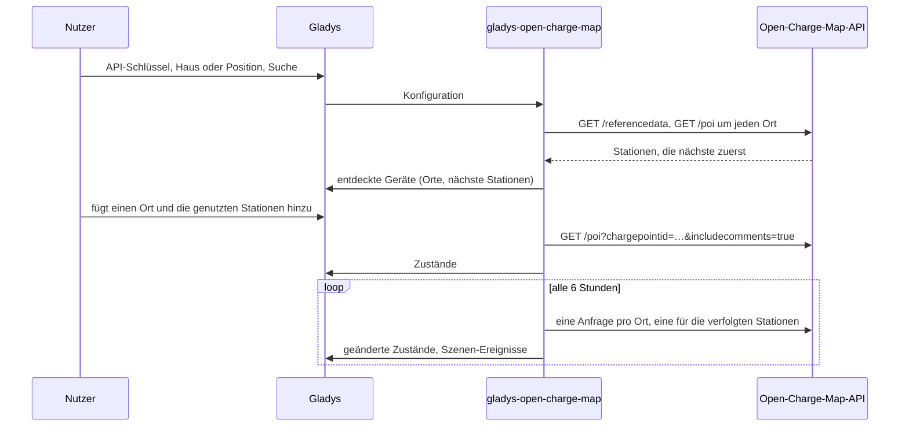
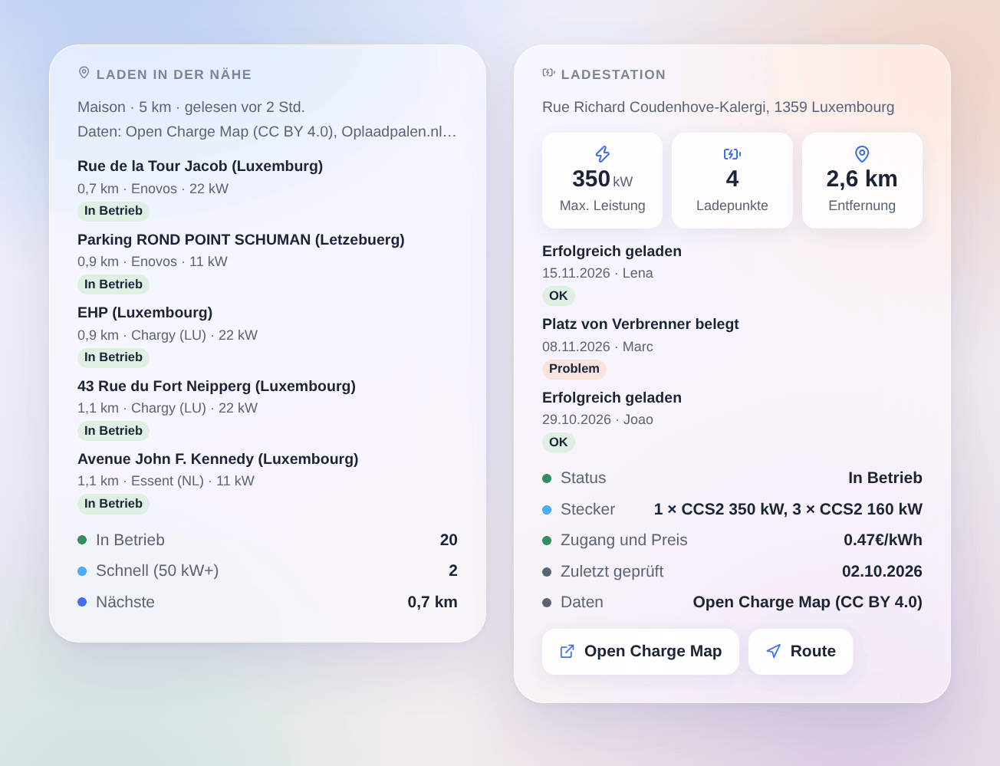

# Gladys Open Charge Map

[English](README.md) · [Français](README.fr.md) · **Deutsch** · [Español](README.es.md)

[](LICENSE)
[](https://github.com/William-De71/gladys-open-charge-map/releases)
[](https://github.com/William-De71/gladys-open-charge-map/actions/workflows/release.yml)
[](https://gladysassistant.com)



Eine externe Integration für [Gladys Assistant](https://gladysassistant.com), die die öffentlichen Ladestationen von [Open Charge Map](https://openchargemap.org), dem offenen weltweiten Verzeichnis, in Gladys bringt. Die Ladestationen in Ihrer Nähe, ihr Status, ihre Leistung und Stecker sowie die Besuche von Fahrern werden zu Geräten, Szenen-Auslösern, einer Szenen-Aktion und Dashboard-Widgets.

## Funktionen

- Ein **Gerät pro Ort** (ein Haus von Gladys oder eine eingegebene Position, bis zu drei): Ladestationen in Betrieb, Schnellladestationen (50 kW+), Entfernung der nächsten, eine Zusammenfassung.
- Ein **Gerät pro verfolgter Ladestation**: Status (Anschlussstatus der Gladys-Ladestationen), Ladepunkte, Details (Leistung, Stecker, Zugang, Preis), letzter Besuch.
- **3 Szenen-Auslöser**: neue Ladestation in der Nähe (Filter: schnell), Status einer Ladestation geändert (außer Betrieb, wieder da), neuer Besuch (Erfolg, Problem, Sonstiges).
- **1 Szenen-Aktion**: die nächste Ladestation eines Ortes für einen Stecker und eine Leistung finden.
- **2 Dashboard-Widgets**: die nächsten Ladestationen (Filter pro Widget, Links zu Open Charge Map und zur Route) und eine Ladestation mit ihren Besuchen.
- Eine Suche nach Umkreis, Mindestleistung, Steckertypen und öffentlichem Zugang; standardmäßig alle 6 Stunden gelesen, mit Ihrem kostenlosen API-Schlüssel.
- Datenlieferant und Lizenz bei jeder Station angezeigt; Englisch, Französisch, Deutsch und Spanisch überall.

## Funktionsweise





Die Integration liest die [offizielle API von Open Charge Map](https://openchargemap.org/develop/api) mit dem persönlichen Schlüssel des Nutzers: `GET /poi` rund um jeden Ort (Umkreis in km, Mindestleistung und Steckertypen, kompakte Antworten, höchstens 250 Stationen), `GET /poi?chargepointid=…&includecomments=true` für die verfolgten Stationen (mit den Besuchen der Fahrer) und `GET /referencedata` einmal täglich (Namen der Betreiber und Datenlieferanten). Jede Abfrage wird mit der vorherigen verglichen: Eine neue Station, ein geänderter Status oder ein neuer Besuch wird zum Szenen-Ereignis. Die erste Abfrage nach einem Start oder nach einer Änderung der Suche dient als Referenz.



Aus Gladys wird nichts gesteuert: Es gibt keinen Schritt `set value`. Ein Widget oder eine Szenen-Aktion kostet nie eine Anfrage: Sie lesen die letzte Abfrage.

### Transport

Nur **Cloud** (`"transports": ["cloud"]`): Gladys zeigt im Katalog das Cloud-Abzeichen. Die Integration spricht nur mit `api.openchargemap.io` und sendet die Position jedes Ortes und die Suche; Ihr API-Schlüssel reist im Header `X-API-Key`.

## Geräte und Funktionen

| Gerät                   | Funktion                 | Gladys-Kategorie / -Typ                |
| ----------------------- | ------------------------ | -------------------------------------- |
| Ladestationen · `<Ort>` | Ladestationen in Betrieb | Zähler (Ganzzahl)                      |
|                         | Schnellladestationen     | Zähler (Ganzzahl)                      |
|                         | Nächste Ladestation      | Entfernungssensor (Dezimal, km)        |
|                         | Zusammenfassung          | Text                                   |
| `<Ladestation>`         | Status                   | Ladestation, Anschlussstatus (0 bis 4) |
|                         | Ladepunkte               | Zähler (Ganzzahl)                      |
|                         | Details                  | Text                                   |
|                         | Letzter Besuch           | Text                                   |

Externe IDs beruhen auf dem Selektor des Hauses oder der eingegebenen Position (`house-maison`, `pos-46-3069-4-8325`) und auf der Open-Charge-Map-ID der Station, nie auf einem Anzeigenamen. Open Charge Map kennt die Live-Belegung selten: Eine Station in Betrieb wird als Verfügbar angezeigt.

## Szenen-Auslöser, Aktionen und Widgets

| Art      | Schlüssel                | Verwendung                                                                        |
| -------- | ------------------------ | --------------------------------------------------------------------------------- |
| Auslöser | `new_station`            | Eine kürzlich gelistete Station erscheint um einen Ort (Filter: schnell)          |
| Auslöser | `station_status_changed` | Eine verfolgte Station fällt aus, ist wieder da oder ändert ihren Status          |
| Auslöser | `new_checkin`            | Ein Fahrer meldet einen Ladevorgang, ein Problem oder einen Kommentar             |
| Aktion   | `find_station`           | Die nächste Station für einen Stecker und eine Leistung, als Ausgaben             |
| Widget   | `nearby`                 | Die nächsten Stationen eines Ortes: Status, Leistung, Stecker, Zugang, Links      |
| Widget   | `station`                | Eine verfolgte Station: Leistung, Ladepunkte, Entfernung, Besuche, Status, Quelle |

Szenen-Beispiele:

- Wenn die Schnellladestation, die ich nutze, ausfällt → eine Nachricht mit `{{triggerEvent.data.summary}}` senden.
- Wenn ein Fahrer ein Problem an meiner üblichen Station meldet → mich vor der Abfahrt benachrichtigen.
- Wenn eine neue Schnellladestation in der Nähe von Zuhause gelistet wird → ihren Namen und `{{triggerEvent.data.distance_km}}` km senden.



## Voraussetzungen

- Gladys Assistant **5.3.0** oder neuer (Hausauswahl, Katalog-Schlagwörter, Widgets und Szenen externer Integrationen). Ältere Instanzen können sie nicht installieren.
- Ein kostenloses [Open-Charge-Map](https://openchargemap.org)-Konto mit API-Schlüssel (My profile → My apps → Register an application).

## Installation

- **Aus dem Store**: Integrationen → „Open Charge Map“ suchen → Installieren.
- **Über die Repository-URL**: Integrationen → Integration installieren → `https://github.com/William-De71/gladys-open-charge-map`.
- **Entwicklermodus**: Integrationen → Integration installieren → Entwicklermodus, mit dem Image `ghcr.io/william-de71/gladys-open-charge-map:<version>`.

## Konfiguration

| Feld                          | Pflicht | Beschreibung                                                             |
| ----------------------------- | ------- | ------------------------------------------------------------------------ |
| API-Schlüssel                 | Ja      | Ihr Open-Charge-Map-Schlüssel (geheim)                                   |
| Haus (Orte 1 bis 3)           | Nein    | Ein Haus von Gladys: Seine Position ist der Mittelpunkt der Suche        |
| Oder eine Position            | Nein    | „46.3069, 4.8325“; hat Vorrang vor dem Haus                              |
| Umkreis                       | Nein    | 1, 2, 5 (Standard), 10, 20 oder 50 km                                    |
| Mindestleistung               | Nein    | Beliebig (Standard), 7, 11, 22, 50 oder 150 kW                           |
| Stecker                       | Nein    | Typ 2, CCS, CHAdeMO, Typ 1, Tesla / NACS, Haushalt; keiner: alle Stecker |
| Nur öffentliche Ladestationen | Nein    | Standardmäßig an                                                         |
| Angebotene Ladestationen      | Nein    | Die 5, 10 (Standard), 20 oder 50 nächsten jedes Ortes                    |
| Open Charge Map gelesen alle  | Nein    | 1, 3, 6 (Standard), 12 oder 24 Stunden                                   |
| Sprache der Texte             | Nein    | Gerätenamen, Zusammenfassungen, Szenentexte; standardmäßig automatisch   |

**Schlüssel und Orte testen** liest Open Charge Map sofort und zeigt die für jeden Ort gefundenen Stationen.

## Verwendung

1. API-Schlüssel einfügen, für jeden Ort ein Haus wählen oder eine Position eingeben und speichern.
2. Geräte → Open Charge Map → Entdecken: die Orte und die genutzten Stationen hinzufügen.
3. Szenen: einen Open-Charge-Map-Auslöser wählen, nach Gerät filtern, die Variablen in einer Nachricht verwenden.
4. Dashboard: die Widgets „Laden in der Nähe“ und „Ladestation“ hinzufügen.

Die Benutzerdokumentation liegt in [docs/de.md](docs/de.md) ([en](docs/en.md), [fr](docs/fr.md), [es](docs/es.md)).

## Entwicklung

```bash
npm install
npm test                       # node --test, ohne Netzwerkzugriff
npm run lint                   # ESLint
npm run format:check           # Prettier
npx github:GladysAssistant/integration-store . --skip-image-check
scripts/build-cover.sh         # cover.jpg aus docs/assets/cover.svg
docs/illustrations/render.sh   # docs/assets/widgets.<sprache>.png
```

Lokal liest das SDK `GLADYS_HOST_API_URL`, `GLADYS_INTEGRATION_TOKEN` und `GLADYS_INTEGRATION_SELECTOR` (von Gladys im Entwicklermodus geliefert). `DEBUG=gladys-integration-sdk` zeigt die SDK-Logs.

Die Tests decken den API-Client, das Lesen der Stationen (Status, Leistung, Stecker, Besuche, Lizenzen), die Filter, die Übergänge, die Geräte, die Widgets (`validateWidgetContent`), die Szenen-Ereignisse und -Ausgaben, das Manifest, die vier Sprachen, das Release-Skript und die ganze Integration gegen den Fake-Gladys des SDK und eine Fake-API mit echten Stationen rund um Luxemburg-Stadt ab (öffentlicher Export von Open Charge Map, CC BY 4.0). `test/structure.test.js` friert jeden von Nutzern gespeicherten Schlüssel ein.

## Release-Prozess


Jeder Merge auf `main` startet die CI und berechnet dann die Version aus den [Conventional Commits](https://www.conventionalcommits.org/de/) seit dem letzten Tag: `feat` → Minor, `fix` / `perf` → Patch, `!` oder `BREAKING CHANGE` → Major (unter 1.0.0 ein Minor); `docs`, `chore`, `ci`, `test`, `style`, `refactor`, `build` allein veröffentlichen nichts. Der Changelog-Abschnitt wird erzeugt, der Tag gepusht, das Multi-Architektur-Image gebaut, dann erhält `main` den Release-Commit, die GitHub Release wird erstellt und ein letzter Job prüft das öffentliche Image, den Store-Validator und das Topic.

- Der Titel des Pull Requests wird zum Squash-Commit und dann zur Changelog-Zeile: auf Englisch, für den Nutzer schreiben (`pr-title.yml` prüft ihn). `CHANGELOG.md` nie von Hand bearbeiten.
- 1.0.0 ist eine Entscheidung: Actions → Release → Run workflow mit `release-as: 1.0.0`. `dry-run` zeigt Version und Notizen, ohne zu veröffentlichen.
- **Geschützter Branch**: Das Release pusht seinen Commit mit `GITHUB_TOKEN` auf `main`. Mit einem Ruleset auf `main`, das strenger ist als „kein Löschen, kein Force-Push“, GitHub Actions zur Bypass-Liste hinzufügen (oder über eine GitHub App pushen), sonst scheitert der Veröffentlichungs-Job mit Anweisungen.
- Nach dem ersten Release das Paket `ghcr.io` öffentlich machen (Package settings → Change visibility), sonst kann Gladys es nicht laden.

## Fehlerbehebung

Siehe [docs/de.md](docs/de.md#fehlerbehebung). Probleme mit den Versionen von Gladys und der Integration und den Logs (`DEBUG=gladys-integration-sdk`) melden, nie mit Ihrem API-Schlüssel.

## Mitwirken

Issues und Pull Requests sind willkommen. Vor einem Pull Request `npm run format:check && npm run lint && npm test` ausführen und alle externen IDs und gespeicherten Schlüssel unverändert lassen (siehe [CLAUDE.md](CLAUDE.md)).

## Sicherheit

Siehe [SECURITY.md](SECURITY.md): Sicherheitslücken vertraulich melden. Der API-Schlüssel wird von Gladys als Geheimnis gespeichert und nur an Open Charge Map gesendet; die Integration sendet die Position jedes Ortes und die Suche an `api.openchargemap.io`, und sonst nichts irgendwohin.

## Screenshots folgen

Die Bilder oben sind Illustrationen, keine Screenshots. Echte Screenshots kommen in `docs/assets/screenshots/` (PNG, 1280 × 800): `configuration.png`, `discovery.png`, `device.png`, `scene.png`.

## Lizenz

[Apache-Lizenz 2.0](LICENSE) — siehe auch [NOTICE](NOTICE). Daten der Ladestationen: Open Charge Map Contributors ([CC BY 4.0](https://creativecommons.org/licenses/by/4.0/deed.de)) und die bei jeder Station genannten Datenlieferanten, unter ihren eigenen Lizenzen ([Bedingungen](https://openchargemap.org/about/terms)). Diese Community-Integration ist nicht mit Open Charge Map verbunden und wird von ihm weder unterstützt noch gesponsert. Dank an die Open-Charge-Map-Community sowie an die Dokumentation und das SDK von Gladys.
