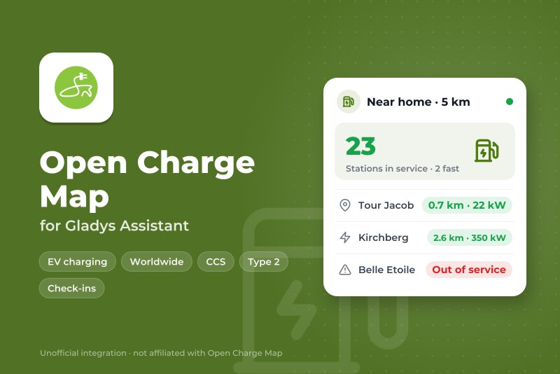
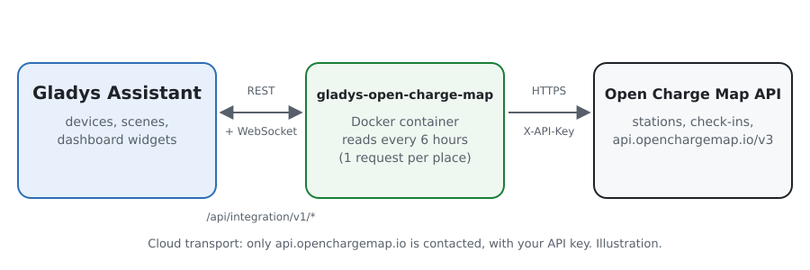
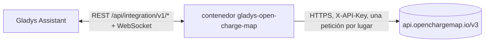
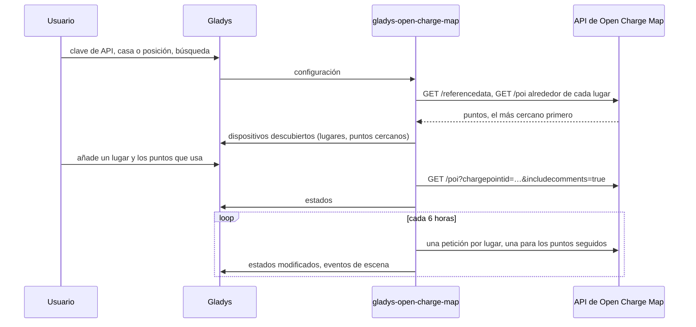
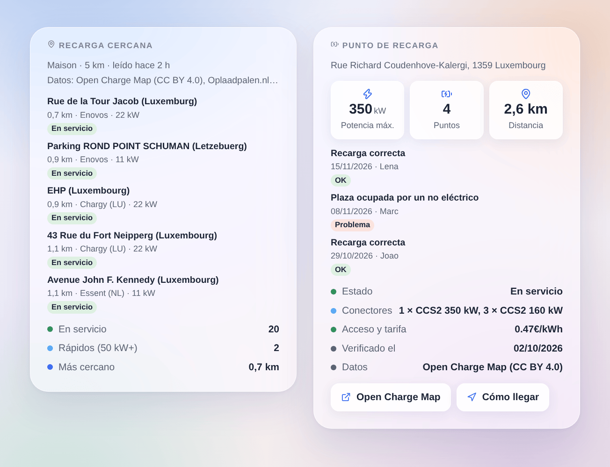

# Gladys Open Charge Map

[English](README.md) · [Français](README.fr.md) · [Deutsch](README.de.md) · **Español**

[](LICENSE)
[](https://github.com/William-De71/gladys-open-charge-map/releases)
[](https://github.com/William-De71/gladys-open-charge-map/actions/workflows/release.yml)
[](https://gladysassistant.com)



Una integración externa para [Gladys Assistant](https://gladysassistant.com) que trae a Gladys los puntos de recarga públicos de [Open Charge Map](https://openchargemap.org), el registro abierto y mundial. Los puntos cerca de su casa, su estado, potencia y conectores, y las visitas de los conductores se convierten en dispositivos, disparadores de escena, una acción de escena y widgets del panel.

## Funcionalidades

- Un **dispositivo por lugar** (una casa de Gladys o una posición escrita, hasta tres): puntos en servicio, puntos rápidos (50 kW+), distancia del más cercano, un resumen.
- Un **dispositivo por punto seguido**: estado (estado del conector de las estaciones de carga de Gladys), puntos de carga, detalles (potencia, conectores, acceso, tarifa), última visita.
- **3 disparadores de escena**: nuevo punto cercano (filtro: rápido), estado de un punto cambiado (fuera de servicio, vuelta), nueva visita (éxito, problema, otro).
- **1 acción de escena**: buscar el punto más cercano de un lugar para un conector y una potencia.
- **2 widgets del panel**: los puntos más cercanos (filtros por widget, enlaces a Open Charge Map y a la ruta), y un punto con sus visitas.
- Una búsqueda por radio, potencia mínima, tipos de conector y acceso público; lectura cada 6 horas por defecto, con su clave de API gratuita.
- El proveedor de los datos y su licencia mostrados con cada punto; inglés, francés, alemán y español en todas partes.

## Funcionamiento





La integración lee la [API oficial de Open Charge Map](https://openchargemap.org/develop/api) con la clave personal del usuario: `GET /poi` alrededor de cada lugar (radio en km, potencia mínima y tipos de conector, respuestas compactas, 250 puntos como máximo), `GET /poi?chargepointid=…&includecomments=true` para los puntos seguidos (con las visitas de los conductores), y `GET /referencedata` una vez al día (nombres de operadores y proveedores de datos). Cada lectura se compara con la anterior: un punto que aparece, un estado que cambia o una nueva visita se convierte en un evento de escena. La primera lectura tras un arranque, o tras un cambio de la búsqueda, sirve de referencia.



Nada se controla desde Gladys: no hay paso `set value`. Un widget o una acción de escena nunca cuesta una petición: leen la última lectura.

### Transporte

Solo **nube** (`"transports": ["cloud"]`): Gladys muestra la insignia Cloud en el catálogo. La integración solo habla con `api.openchargemap.io`, al que envía la posición de cada lugar y la búsqueda; su clave de API viaja en la cabecera `X-API-Key`.

## Dispositivos y funciones

| Dispositivo                   | Función            | Categoría / tipo de Gladys                     |
| ----------------------------- | ------------------ | ---------------------------------------------- |
| Puntos de recarga · `<lugar>` | Puntos en servicio | Contador (entero)                              |
|                               | Puntos rápidos     | Contador (entero)                              |
|                               | Punto más cercano  | Sensor de distancia (decimal, km)              |
|                               | Resumen            | Texto                                          |
| `<punto>`                     | Estado             | Estación de carga, estado del conector (0 a 4) |
|                               | Puntos de carga    | Contador (entero)                              |
|                               | Detalles           | Texto                                          |
|                               | Última visita      | Texto                                          |

Los identificadores externos se basan en el selector de la casa o la posición escrita (`house-maison`, `pos-46-3069-4-8325`) y en el identificador de Open Charge Map del punto, nunca en un nombre mostrado. Open Charge Map rara vez conoce la ocupación en directo: un punto en servicio se muestra como Disponible.

## Disparadores, acciones y widgets

| Tipo       | Clave                    | Uso                                                                       |
| ---------- | ------------------------ | ------------------------------------------------------------------------- |
| Disparador | `new_station`            | Un punto recién listado aparece alrededor de un lugar (filtro: rápido)    |
| Disparador | `station_status_changed` | Un punto seguido queda fuera de servicio, vuelve, o cambia de estado      |
| Disparador | `new_checkin`            | Un conductor indica una recarga, un problema o un comentario              |
| Acción     | `find_station`           | El punto más cercano para un conector y una potencia, como salidas        |
| Widget     | `nearby`                 | Los puntos más cercanos de un lugar: estado, potencia, conectores, acceso |
| Widget     | `station`                | Un punto seguido: potencia, puntos, distancia, visitas, estado, fuente    |

Ejemplos de escenas:

- Cuando el punto rápido que uso queda fuera de servicio → enviar un mensaje con `{{triggerEvent.data.summary}}`.
- Cuando un conductor indica un problema en mi punto habitual → avisarme antes de salir.
- Cuando se lista un nuevo punto rápido cerca de casa → enviar su nombre y `{{triggerEvent.data.distance_km}}` km.



## Requisitos

- Gladys Assistant **5.3.0** o posterior (selector de casa, palabras clave del catálogo, widgets y escenas de integraciones externas). Las instancias más antiguas no pueden instalarla.
- Una cuenta y una clave de API de [Open Charge Map](https://openchargemap.org) gratuitas (My profile → My apps → Register an application).

## Instalación

- **Desde la tienda**: Integraciones → buscar «Open Charge Map» → Instalar.
- **Desde la URL del repositorio**: Integraciones → Instalar una integración → `https://github.com/William-De71/gladys-open-charge-map`.
- **Modo desarrollador**: Integraciones → Instalar una integración → Modo desarrollador, con la imagen `ghcr.io/william-de71/gladys-open-charge-map:<version>`.

## Configuración

| Campo                      | Obligatorio | Descripción                                                                   |
| -------------------------- | ----------- | ----------------------------------------------------------------------------- |
| Clave de API               | Sí          | Su clave de Open Charge Map (secreta)                                         |
| Casa (lugares 1 a 3)       | No          | Una casa de Gladys: su posición es el centro de la búsqueda                   |
| O una posición             | No          | «46.3069, 4.8325»; prevalece sobre la casa                                    |
| Radio                      | No          | 1, 2, 5 (por defecto), 10, 20 o 50 km                                         |
| Potencia mínima            | No          | Cualquiera (por defecto), 7, 11, 22, 50 o 150 kW                              |
| Conectores                 | No          | Tipo 2, CCS, CHAdeMO, Tipo 1, Tesla / NACS, doméstico; ninguno: todos         |
| Solo puntos públicos       | No          | Activado por defecto                                                          |
| Puntos propuestos          | No          | Los 5, 10 (por defecto), 20 o 50 más cercanos de cada lugar                   |
| Open Charge Map leído cada | No          | 1, 3, 6 (por defecto), 12 o 24 horas                                          |
| Idioma de los textos       | No          | Nombres de dispositivos, resúmenes, textos de escenas; automático por defecto |

**Probar la clave y los lugares** lee Open Charge Map al momento y muestra los puntos encontrados para cada lugar.

## Uso

1. Pegue la clave de API, elija una casa o escriba una posición para cada lugar y guarde.
2. Dispositivos → Open Charge Map → Descubrir: añada los lugares y los puntos que utiliza.
3. Escenas: elija un disparador de Open Charge Map, filtre por un dispositivo, use las variables en un mensaje.
4. Panel: añada los widgets «Recarga cercana» y «Punto de recarga».

La documentación de usuario está en [docs/es.md](docs/es.md) ([en](docs/en.md), [fr](docs/fr.md), [de](docs/de.md)).

## Desarrollo

```bash
npm install
npm test                       # node --test, sin tocar nunca la red
npm run lint                   # ESLint
npm run format:check           # Prettier
npx github:GladysAssistant/integration-store . --skip-image-check
scripts/build-cover.sh         # cover.jpg desde docs/assets/cover.svg
docs/illustrations/render.sh   # docs/assets/widgets.<idioma>.png
```

En local, el SDK lee `GLADYS_HOST_API_URL`, `GLADYS_INTEGRATION_TOKEN` y `GLADYS_INTEGRATION_SELECTOR` (dados por Gladys en modo desarrollador). `DEBUG=gladys-integration-sdk` muestra los registros del SDK.

Las pruebas cubren el cliente de la API, la lectura de los puntos (estado, potencia, conectores, visitas, licencias), los filtros, las transiciones, los dispositivos, los widgets (`validateWidgetContent`), los eventos y salidas de escena, el manifiesto, los cuatro idiomas, el script de release, y toda la integración frente al Gladys falso del SDK y una API falsa que devuelve puntos reales alrededor de la ciudad de Luxemburgo (exportación pública de Open Charge Map, CC BY 4.0). `test/structure.test.js` congela cada clave que guardan los usuarios.

## Proceso de release


Cada fusión en `main` lanza la CI y luego calcula la versión a partir de los [Conventional Commits](https://www.conventionalcommits.org/es/) desde la última etiqueta: `feat` → menor, `fix` / `perf` → parche, `!` o `BREAKING CHANGE` → mayor (una menor por debajo de 1.0.0); `docs`, `chore`, `ci`, `test`, `style`, `refactor`, `build` solos no publican nada. Se genera la sección del changelog, se empuja la etiqueta, se construye la imagen multiarquitectura, luego `main` recibe el commit de release, se crea la GitHub Release y un último job comprueba la imagen pública, el validador de la tienda y el topic.

- El título de la pull request se convierte en el commit squash y luego en la línea del changelog: escríbalo en inglés, para el usuario (`pr-title.yml` lo comprueba). No edite nunca `CHANGELOG.md` a mano.
- 1.0.0 es una decisión: Actions → Release → Run workflow con `release-as: 1.0.0`. `dry-run` muestra la versión y las notas sin publicar.
- **Rama protegida**: unos rulesets exigen una pull request en `main` y bloquean las etiquetas `v*`; solo pasan el mantenedor y las deploy keys. La publicación hace push con la deploy key del entorno `release` (secreto `RELEASE_DEPLOY_KEY`, solo `main`): una ejecución lanzada desde otra rama nunca la obtiene. `build.yml` y `github-release.yml` no arrancan con una etiqueta: la publicación los llama, o lánzelos a mano (Actions → Run workflow, con `version` para la imagen) para terminar una publicación.
- Tras la primera release, haga público el paquete `ghcr.io` (Package settings → Change visibility); si no, Gladys no puede descargarlo.

## Solución de problemas

Vea [docs/es.md](docs/es.md#solución-de-problemas). Informe de los problemas con las versiones de Gladys y de la integración y los registros (`DEBUG=gladys-integration-sdk`), nunca con su clave de API.

## Contribuir

Las issues y pull requests son bienvenidas. Ejecute `npm run format:check && npm run lint && npm test` antes de abrir una pull request, y mantenga sin cambios todos los identificadores externos y claves guardadas (vea [CLAUDE.md](CLAUDE.md)).

## Seguridad

Vea [SECURITY.md](SECURITY.md): informe de las vulnerabilidades en privado. Gladys guarda la clave de API como secreto y solo se envía a Open Charge Map; la integración envía la posición de cada lugar y la búsqueda a `api.openchargemap.io`, y nada más a ningún sitio.

## Capturas próximamente

Las imágenes de arriba son ilustraciones, no capturas. Las capturas reales irán en `docs/assets/screenshots/` (PNG, 1280 × 800): `configuration.png`, `discovery.png`, `device.png`, `scene.png`.

## Licencia

[Licencia Apache 2.0](LICENSE) — vea también [NOTICE](NOTICE). Datos de los puntos: Open Charge Map Contributors ([CC BY 4.0](https://creativecommons.org/licenses/by/4.0/deed.es)) y los proveedores de datos citados en cada punto, bajo sus propias licencias ([condiciones](https://openchargemap.org/about/terms)). Esta integración comunitaria no está afiliada a Open Charge Map ni respaldada o patrocinada por él. Gracias a la comunidad de Open Charge Map, y a la documentación y el SDK de Gladys.
