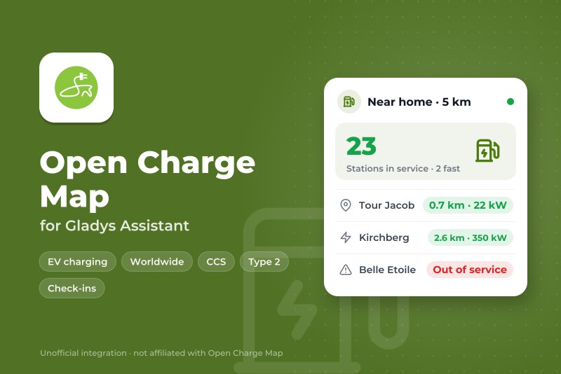
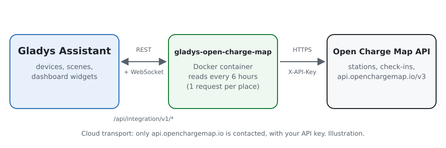
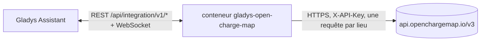
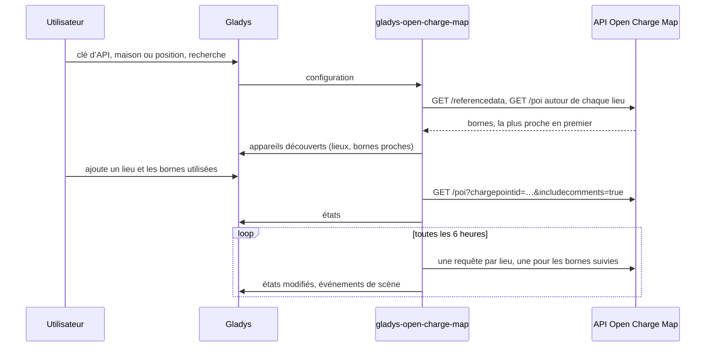
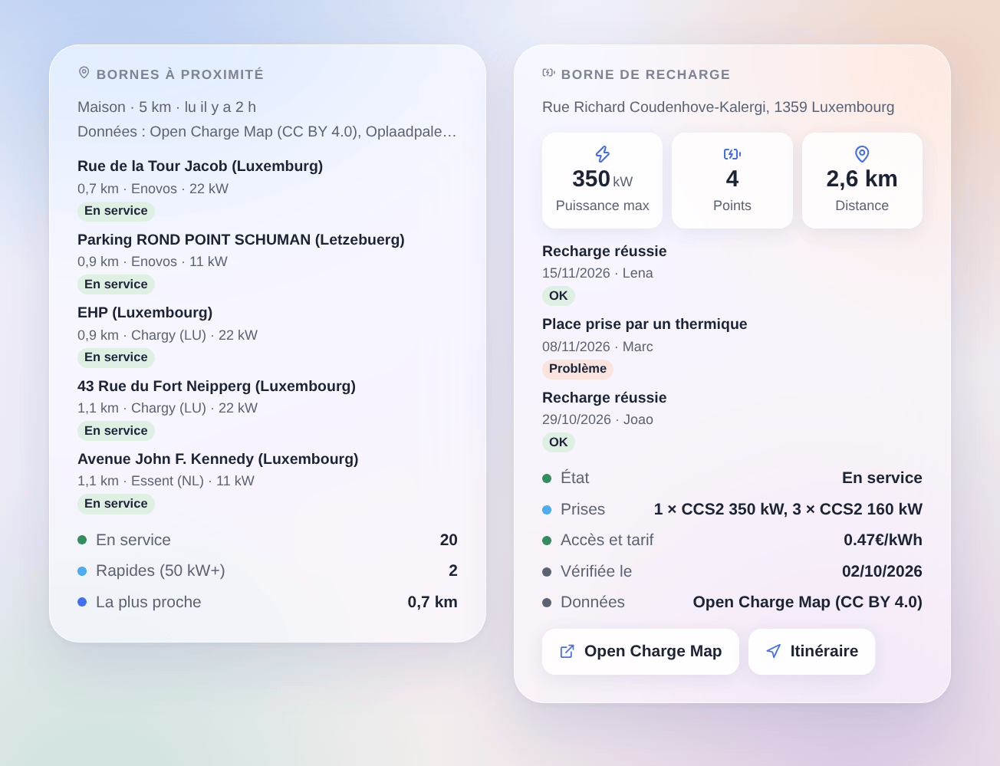

# Gladys Open Charge Map

[English](README.md) · **Français** · [Deutsch](README.de.md) · [Español](README.es.md)

[](LICENSE)
[](https://github.com/William-De71/gladys-open-charge-map/releases)
[](https://github.com/William-De71/gladys-open-charge-map/actions/workflows/release.yml)
[](https://gladysassistant.com)



Une intégration externe pour [Gladys Assistant](https://gladysassistant.com) qui amène dans Gladys les bornes de recharge publiques d’[Open Charge Map](https://openchargemap.org), le registre ouvert et mondial. Les bornes autour de chez vous, leur état, leur puissance et leurs prises, et les passages des conducteurs deviennent des appareils, des déclencheurs de scène, une action de scène et des widgets.

## Fonctionnalités

- Un **appareil par lieu** (une maison de Gladys ou une position saisie, jusqu’à trois) : bornes en service, bornes rapides (50 kW+), distance de la plus proche, un résumé.
- Un **appareil par borne suivie** : état (statut de connecteur des bornes de recharge Gladys), points de charge, détails (puissance, prises, accès, tarif), dernier passage.
- **3 déclencheurs de scène** : nouvelle borne à proximité (filtre : rapide), état d’une borne modifié (hors service, retour), nouveau passage (réussite, problème, autre).
- **1 action de scène** : trouver la borne la plus proche d’un lieu pour une prise et une puissance.
- **2 widgets** : les bornes les plus proches (filtres par widget, liens vers Open Charge Map et l’itinéraire), et une borne avec ses passages.
- Une recherche par rayon, puissance minimale, types de prises et accès public ; lecture toutes les 6 heures par défaut, avec votre clé d’API gratuite.
- Le fournisseur des données et sa licence affichés avec chaque borne ; anglais, français, allemand et espagnol partout.

## Fonctionnement





L’intégration lit l’[API officielle d’Open Charge Map](https://openchargemap.org/develop/api) avec la clé personnelle de l’utilisateur : `GET /poi` autour de chaque lieu (rayon en km, puissance minimale et types de prises, réponses compactes, 250 bornes au plus), `GET /poi?chargepointid=…&includecomments=true` pour les bornes suivies (avec les passages des conducteurs), et `GET /referencedata` une fois par jour (noms des opérateurs et des fournisseurs de données). Chaque lecture est comparée à la précédente : une borne qui apparaît, un état qui change ou un nouveau passage devient un événement de scène. La première lecture après un démarrage, ou après un changement de recherche, sert de référence.



Rien ne se pilote depuis Gladys : il n’y a pas d’étape `set value`. Un widget ou une action de scène ne coûte jamais de requête : ils lisent la dernière lecture.

### Transport

**Cloud** seulement (`"transports": ["cloud"]`) : Gladys affiche le badge Cloud dans le catalogue. L’intégration ne parle qu’à `api.openchargemap.io`, à qui elle envoie la position de chaque lieu et la recherche ; votre clé d’API passe dans l’en-tête `X-API-Key`.

## Appareils et fonctionnalités

| Appareil                      | Fonctionnalité       | Catégorie / type Gladys                         |
| ----------------------------- | -------------------- | ----------------------------------------------- |
| Bornes de recharge · `<lieu>` | Bornes en service    | Compteur (entier)                               |
|                               | Bornes rapides       | Compteur (entier)                               |
|                               | Borne la plus proche | Capteur de distance (décimal, km)               |
|                               | Résumé               | Texte                                           |
| `<borne>`                     | État                 | Borne de recharge, statut du connecteur (0 à 4) |
|                               | Points de charge     | Compteur (entier)                               |
|                               | Détails              | Texte                                           |
|                               | Dernier passage      | Texte                                           |

Les identifiants externes reposent sur le sélecteur de la maison ou la position saisie (`house-maison`, `pos-46-3069-4-8325`) et sur l’identifiant Open Charge Map de la borne, jamais sur un nom affiché. Open Charge Map connaît rarement l’occupation en direct : une borne en service s’affiche Disponible.

## Déclencheurs, actions et widgets

| Type        | Clé                      | Usage                                                                         |
| ----------- | ------------------------ | ----------------------------------------------------------------------------- |
| Déclencheur | `new_station`            | Une borne récemment listée apparaît autour d’un lieu (filtre : rapide)        |
| Déclencheur | `station_status_changed` | Une borne suivie passe hors service, revient, ou change d’état                |
| Déclencheur | `new_checkin`            | Un conducteur signale une recharge, un problème ou un commentaire             |
| Action      | `find_station`           | La borne la plus proche pour une prise et une puissance, en sorties           |
| Widget      | `nearby`                 | Les bornes les plus proches d’un lieu : état, puissance, prises, accès, liens |
| Widget      | `station`                | Une borne suivie : puissance, points, distance, passages, état, source        |

Exemples de scènes :

- Quand la borne rapide que j’utilise passe hors service → envoyer un message avec `{{triggerEvent.data.summary}}`.
- Quand un conducteur signale un problème sur ma borne habituelle → me prévenir avant de partir.
- Quand une nouvelle borne rapide est listée près de la maison → envoyer son nom et `{{triggerEvent.data.distance_km}}` km.



## Prérequis

- Gladys Assistant **5.3.0** ou plus récent (sélecteur de maison, mots-clés du catalogue, widgets et scènes des intégrations externes). Les instances plus anciennes ne peuvent pas l’installer.
- Un compte [Open Charge Map](https://openchargemap.org) et une clé d’API gratuits (My profile → My apps → Register an application).

## Installation

- **Depuis le store** : Intégrations → chercher « Open Charge Map » → Installer.
- **Depuis l’URL du dépôt** : Intégrations → Installer une intégration → `https://github.com/William-De71/gladys-open-charge-map`.
- **Mode développeur** : Intégrations → Installer une intégration → Mode développeur, avec l’image `ghcr.io/william-de71/gladys-open-charge-map:<version>`.

## Configuration

| Champ                         | Obligatoire | Description                                                              |
| ----------------------------- | ----------- | ------------------------------------------------------------------------ |
| Clé d’API                     | Oui         | Votre clé Open Charge Map (secrète)                                      |
| Maison (lieux 1 à 3)          | Non         | Une maison de Gladys : sa position est le centre de la recherche         |
| Ou une position               | Non         | « 46.3069, 4.8325 » ; prime sur la maison                                |
| Rayon                         | Non         | 1, 2, 5 (par défaut), 10, 20 ou 50 km                                    |
| Puissance minimale            | Non         | Toutes (par défaut), 7, 11, 22, 50 ou 150 kW                             |
| Prises                        | Non         | Type 2, CCS, CHAdeMO, Type 1, Tesla / NACS, domestique ; aucune : toutes |
| Bornes publiques seulement    | Non         | Activé par défaut                                                        |
| Bornes proposées              | Non         | Les 5, 10 (par défaut), 20 ou 50 plus proches de chaque lieu             |
| Open Charge Map lu toutes les | Non         | 1, 3, 6 (par défaut), 12 ou 24 heures                                    |
| Langue des textes             | Non         | Noms des appareils, résumés, textes des scènes ; automatique par défaut  |

**Tester la clé et les lieux** lit Open Charge Map tout de suite et affiche les bornes trouvées pour chaque lieu.

## Utilisation

1. Collez la clé d’API, choisissez une maison ou saisissez une position pour chaque lieu, puis enregistrez.
2. Appareils → Open Charge Map → Découverte : ajoutez les lieux et les bornes que vous utilisez.
3. Scènes : choisissez un déclencheur Open Charge Map, filtrez sur un appareil, utilisez les variables dans un message.
4. Tableau de bord : ajoutez les widgets « Bornes à proximité » et « Borne de recharge ».

La documentation utilisateur est dans [docs/fr.md](docs/fr.md) ([en](docs/en.md), [de](docs/de.md), [es](docs/es.md)).

## Développement

```bash
npm install
npm test                       # node --test, sans jamais toucher le réseau
npm run lint                   # ESLint
npm run format:check           # Prettier
npx github:GladysAssistant/integration-store . --skip-image-check
scripts/build-cover.sh         # cover.jpg depuis docs/assets/cover.svg
docs/illustrations/render.sh   # docs/assets/widgets.<langue>.png
```

En local, le SDK lit `GLADYS_HOST_API_URL`, `GLADYS_INTEGRATION_TOKEN` et `GLADYS_INTEGRATION_SELECTOR` (donnés par Gladys en mode développeur). `DEBUG=gladys-integration-sdk` affiche les journaux du SDK.

Les tests couvrent le client de l’API, la lecture des bornes (état, puissance, prises, passages, licences), les filtres, les transitions, les appareils, les widgets (`validateWidgetContent`), les événements et sorties de scène, le manifeste, les quatre langues, le script de release, et toute l’intégration face au faux Gladys du SDK et à une fausse API qui renvoie de vraies bornes autour de Luxembourg-Ville (export public d’Open Charge Map, CC BY 4.0). `test/structure.test.js` fige chaque clé que les utilisateurs stockent.

## Processus de release


Chaque fusion sur `main` lance la CI, puis calcule la version depuis les [Conventional Commits](https://www.conventionalcommits.org/fr/) depuis le dernier tag : `feat` → mineure, `fix` / `perf` → correctif, `!` ou `BREAKING CHANGE` → majeure (une mineure sous 1.0.0) ; `docs`, `chore`, `ci`, `test`, `style`, `refactor`, `build` seuls ne publient rien. La section du changelog est générée, le tag poussé, l’image multi-architecture construite, puis `main` reçoit le commit de release, la GitHub Release est créée et un dernier job vérifie l’image publique, le validateur du store et le topic.

- Le titre de la pull request devient le commit squash, puis la ligne du changelog : écrivez-le en anglais, pour l’utilisateur (`pr-title.yml` le vérifie). Ne modifiez jamais `CHANGELOG.md` à la main.
- 1.0.0 est une décision : Actions → Release → Run workflow avec `release-as: 1.0.0`. `dry-run` montre la version et les notes sans rien publier.
- **Branche protégée** : la release pousse son commit sur `main` avec `GITHUB_TOKEN`. Avec un ruleset sur `main` plus strict que « pas de suppression, pas de force push », ajoutez GitHub Actions à sa liste de contournement (ou poussez via une GitHub App), sinon le job de publication échoue avec des instructions.
- Après la première release, rendez public le package `ghcr.io` (Package settings → Change visibility), sinon Gladys ne peut pas le télécharger.

## Dépannage

Voir [docs/fr.md](docs/fr.md#dépannage). Signalez les problèmes avec les versions de Gladys et de l’intégration et les journaux (`DEBUG=gladys-integration-sdk`), jamais avec votre clé d’API.

## Contribuer

Issues et pull requests bienvenues. Lancez `npm run format:check && npm run lint && npm test` avant d’ouvrir une pull request, et gardez inchangés tous les identifiants externes et clés stockées (voir [CLAUDE.md](CLAUDE.md)).

## Sécurité

Voir [SECURITY.md](SECURITY.md) : signalez les failles en privé. La clé d’API est stockée par Gladys comme secret et envoyée à Open Charge Map seulement ; l’intégration envoie la position de chaque lieu et la recherche à `api.openchargemap.io`, et rien d’autre nulle part.

## Captures à venir

Les images ci-dessus sont des illustrations, pas des captures. Les vraies captures iront dans `docs/assets/screenshots/` (PNG, 1280 × 800) : `configuration.png`, `discovery.png`, `device.png`, `scene.png`.

## Licence

[Licence Apache 2.0](LICENSE) — voir aussi [NOTICE](NOTICE). Données des bornes : Open Charge Map Contributors ([CC BY 4.0](https://creativecommons.org/licenses/by/4.0/deed.fr)) et les fournisseurs de données cités sur chaque borne, sous leurs propres licences ([conditions](https://openchargemap.org/about/terms)). Cette intégration communautaire n’est ni affiliée à Open Charge Map, ni approuvée ou soutenue par lui. Merci à la communauté d’Open Charge Map, ainsi qu’à la documentation et au SDK de Gladys.
