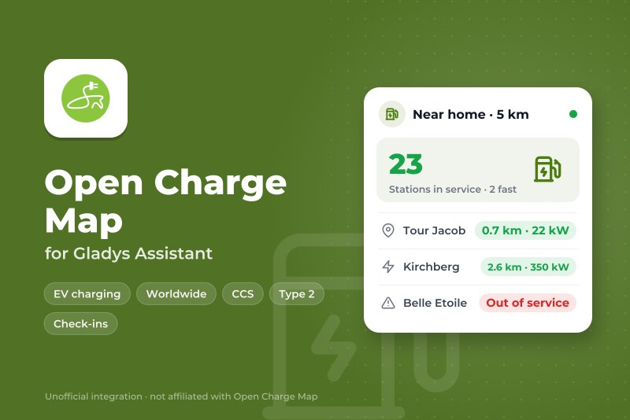
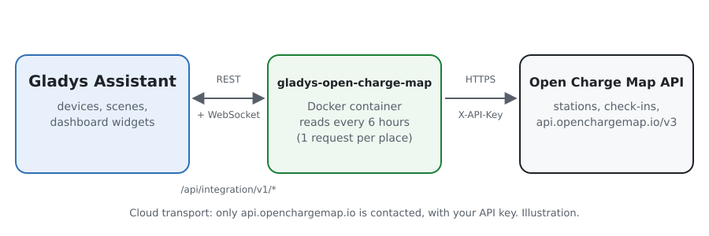
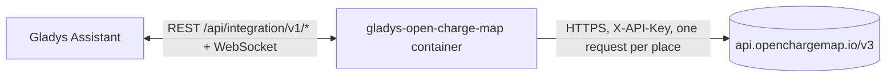
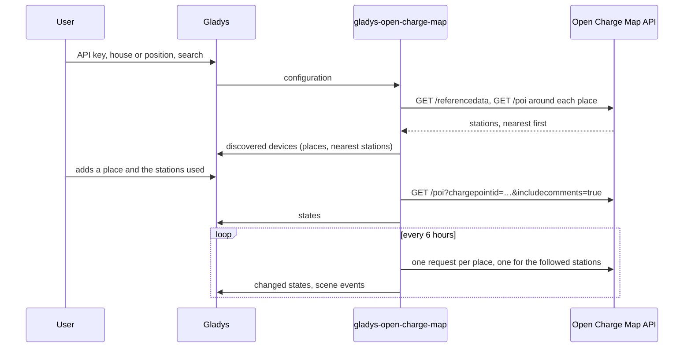
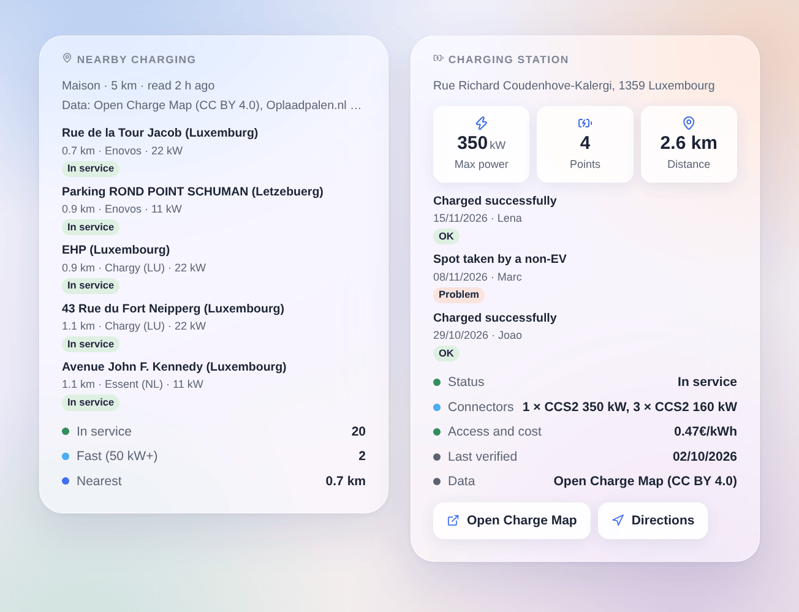

# Gladys Open Charge Map

**English** · [Français](README.fr.md) · [Deutsch](README.de.md) · [Español](README.es.md)

[](LICENSE)
[](https://github.com/William-De71/gladys-open-charge-map/releases)
[](https://github.com/William-De71/gladys-open-charge-map/actions/workflows/release.yml)
[](https://gladysassistant.com)



An external integration for [Gladys Assistant](https://gladysassistant.com) that brings the public EV charging stations of [Open Charge Map](https://openchargemap.org), the open worldwide registry, into Gladys. The stations around your home, their status, power and connectors, and the check-ins of drivers become devices, scene triggers, a scene action and dashboard widgets.

## Features

- A **device per place** (a house of Gladys or a typed position, up to three): stations in service, fast stations (50 kW+), distance to the nearest one, a summary.
- A **device per station you follow**: status (Gladys charging station connector status), charging points, details (power, connectors, access, cost), last check-in.
- **3 scene triggers**: new station nearby (filter: fast), status of a station changed (out of service, back), new check-in (success, problem, other).
- **1 scene action**: find the nearest station of a place for a connector and a power.
- **2 dashboard widgets**: the nearest stations (filters per widget, links to Open Charge Map and to the directions), and one station with its check-ins.
- A search per radius, minimum power, connector types and public access; read every 6 hours by default, with your free API key.
- The data provider and its licence shown with every station; English, French, German and Spanish everywhere.

## How it works





The integration reads the official [Open Charge Map API](https://openchargemap.org/develop/api) with the personal key of the user: `GET /poi` around each place (radius in km, minimum power and connector types, compact answers, 250 stations at most), `GET /poi?chargepointid=…&includecomments=true` for the stations you follow (with the check-ins of drivers), and `GET /referencedata` once a day (operator and data provider names). Each reading is compared with the previous one: a station that appears, a status that changes or a new check-in becomes a scene event. The first reading after a start, or after a change of the search, is a reference.



Nothing is controlled from Gladys: there is no `set value` step. A widget or a scene action never costs a request: they read the last reading.

### Transport

**Cloud** only (`"transports": ["cloud"]`): Gladys shows the Cloud badge in the catalog. The integration talks to `api.openchargemap.io` only, sending the position of each place and the search; your API key travels in the `X-API-Key` header.

## Devices and features

| Device                        | Feature             | Gladys category / type                      |
| ----------------------------- | ------------------- | ------------------------------------------- |
| Charging stations · `<place>` | Stations in service | Counter (integer)                           |
|                               | Fast stations       | Counter (integer)                           |
|                               | Nearest station     | Distance sensor (decimal, km)               |
|                               | Summary             | Text                                        |
| `<station>`                   | Status              | Charging station, connector status (0 to 4) |
|                               | Charging points     | Counter (integer)                           |
|                               | Details             | Text                                        |
|                               | Last check-in       | Text                                        |

External ids rely on the house selector or the typed position (`house-maison`, `pos-46-3069-4-8325`) and on the Open Charge Map station id, never on a display name. Open Charge Map rarely knows the live occupancy: a station in service is shown as Available.

## Scene triggers, actions and widgets

| Kind    | Key                      | Use                                                                       |
| ------- | ------------------------ | ------------------------------------------------------------------------- |
| Trigger | `new_station`            | A station recently listed appears around a place (filter: fast)           |
| Trigger | `station_status_changed` | A followed station goes out of service, comes back, or changes status     |
| Trigger | `new_checkin`            | A driver reports a charge, a problem or a comment at a followed station   |
| Action  | `find_station`           | The nearest station for a connector and a power, as outputs               |
| Widget  | `nearby`                 | The nearest stations of a place: status, power, connectors, access, links |
| Widget  | `station`                | One followed station: power, points, distance, check-ins, status, source  |

Scene examples:

- When the fast charger I use goes out of service → send a message with `{{triggerEvent.data.summary}}`.
- When a driver reports a problem at my usual station → notify me before I leave.
- When a new fast station is listed near home → send its name and `{{triggerEvent.data.distance_km}}` km.



## Requirements

- Gladys Assistant **5.3.0** or later (house selector, catalog keywords, widgets and scenes of external integrations). Older instances cannot install it.
- A free [Open Charge Map](https://openchargemap.org) account and API key (My profile → My apps → Register an application).

## Installation

- **From the store**: Integrations → search "Open Charge Map" → Install.
- **From the repository URL**: Integrations → Install an integration → `https://github.com/William-De71/gladys-open-charge-map`.
- **Developer mode**: Integrations → Install an integration → Developer mode, with the image `ghcr.io/william-de71/gladys-open-charge-map:<version>`.

## Configuration

| Field                      | Required | Description                                                                 |
| -------------------------- | -------- | --------------------------------------------------------------------------- |
| API key                    | Yes      | Your Open Charge Map key (secret)                                           |
| House (places 1 to 3)      | No       | A house of Gladys: its position is the center of the search                 |
| Or a position              | No       | "46.3069, 4.8325"; wins over the house                                      |
| Radius                     | No       | 1, 2, 5 (default), 10, 20 or 50 km                                          |
| Minimum power              | No       | Any (default), 7, 11, 22, 50 or 150 kW                                      |
| Connectors                 | No       | Type 2, CCS, CHAdeMO, Type 1, Tesla / NACS, domestic; none: every connector |
| Public stations only       | No       | On by default                                                               |
| Stations offered           | No       | The 5, 10 (default), 20 or 50 nearest of each place                         |
| Open Charge Map read every | No       | 1, 3, 6 (default), 12 or 24 hours                                           |
| Language of the texts      | No       | Device names, summaries, scene texts; automatic by default                  |

**Test the key and the places** reads Open Charge Map at once and shows the stations found for each place.

## Usage

1. Paste the API key, choose a house or type a position for each place, then save.
2. Devices → Open Charge Map → Discover: add the places and the stations you use.
3. Scenes: pick an Open Charge Map trigger, filter on a device, use the variables in a message.
4. Dashboard: add the "Nearby charging" and "Charging station" widgets.

The user documentation is in [docs/en.md](docs/en.md) ([fr](docs/fr.md), [de](docs/de.md), [es](docs/es.md)).

## Development

```bash
npm install
npm test                       # node --test, never touches the network
npm run lint                   # ESLint
npm run format:check           # Prettier
npx github:GladysAssistant/integration-store . --skip-image-check
scripts/build-cover.sh         # cover.jpg from docs/assets/cover.svg
docs/illustrations/render.sh   # docs/assets/widgets.<lang>.png
```

Locally, the SDK reads `GLADYS_HOST_API_URL`, `GLADYS_INTEGRATION_TOKEN` and `GLADYS_INTEGRATION_SELECTOR` (given by Gladys in developer mode). `DEBUG=gladys-integration-sdk` shows the SDK logs.

The tests cover the API client, the reading of the stations (status, power, connectors, check-ins, licences), the filters, the transitions, the devices, the widgets (`validateWidgetContent`), the scene events and outputs, the manifest, the four languages, the release script, and the whole integration against the fake Gladys of the SDK and a fake API answering real stations around Luxembourg City (public export of Open Charge Map, CC BY 4.0). `test/structure.test.js` freezes every key users store.

## Release process


Every merge on `main` runs the CI, then computes the version from the [Conventional Commits](https://www.conventionalcommits.org/) since the last tag: `feat` → minor, `fix` / `perf` → patch, `!` or `BREAKING CHANGE` → major (a minor below 1.0.0); `docs`, `chore`, `ci`, `test`, `style`, `refactor`, `build` alone publish nothing. The changelog section is generated, the tag pushed, the multi-architecture image built, then `main` receives the release commit, the GitHub Release is created and a last job checks the public image, the store validator and the topic.

- The pull request title becomes the squash commit, then the changelog line: write it in English, for the user (`pr-title.yml` checks it). Never edit `CHANGELOG.md` by hand.
- 1.0.0 is a decision: Actions → Release → Run workflow with `release-as: 1.0.0`. `dry-run` shows the version and the notes without publishing.
- **Protected branch**: rulesets require a pull request on `main` and lock the `v*` tags; only the maintainer and deploy keys get through. The release pushes with the deploy key of the `release` environment (secret `RELEASE_DEPLOY_KEY`, `main` only): a run from another branch never gets it. `build.yml` and `github-release.yml` do not start on a tag: the release calls them, or run them by hand (Actions → Run workflow, with `version` for the image) to finish a release.
- After the first release, make the `ghcr.io` package public (Package settings → Change visibility), or Gladys cannot pull it.

## Troubleshooting

See [docs/en.md](docs/en.md#troubleshooting). Report issues with the Gladys and integration versions and the logs (`DEBUG=gladys-integration-sdk`), never with your API key.

## Contributing

Issues and pull requests are welcome. Run `npm run format:check && npm run lint && npm test` before opening a pull request, and keep every external id and stored key unchanged (see [CLAUDE.md](CLAUDE.md)).

## Security

See [SECURITY.md](SECURITY.md): report vulnerabilities privately. The API key is stored by Gladys as a secret and sent only to Open Charge Map; the integration sends the position of each place and the search to `api.openchargemap.io`, and nothing else anywhere.

## Screenshots to come

The images above are illustrations, not screenshots. Real screenshots will go in `docs/assets/screenshots/` (PNG, 1280 × 800): `configuration.png`, `discovery.png`, `device.png`, `scene.png`.

## License

[Apache License 2.0](LICENSE) — see also [NOTICE](NOTICE). Charging station data: Open Charge Map Contributors ([CC BY 4.0](https://creativecommons.org/licenses/by/4.0/)) and the data providers named on each station, under their own licences ([terms](https://openchargemap.org/about/terms)). This community integration is not affiliated with, endorsed or sponsored by Open Charge Map. Thanks to the Open Charge Map community, and to the Gladys documentation and SDK.
