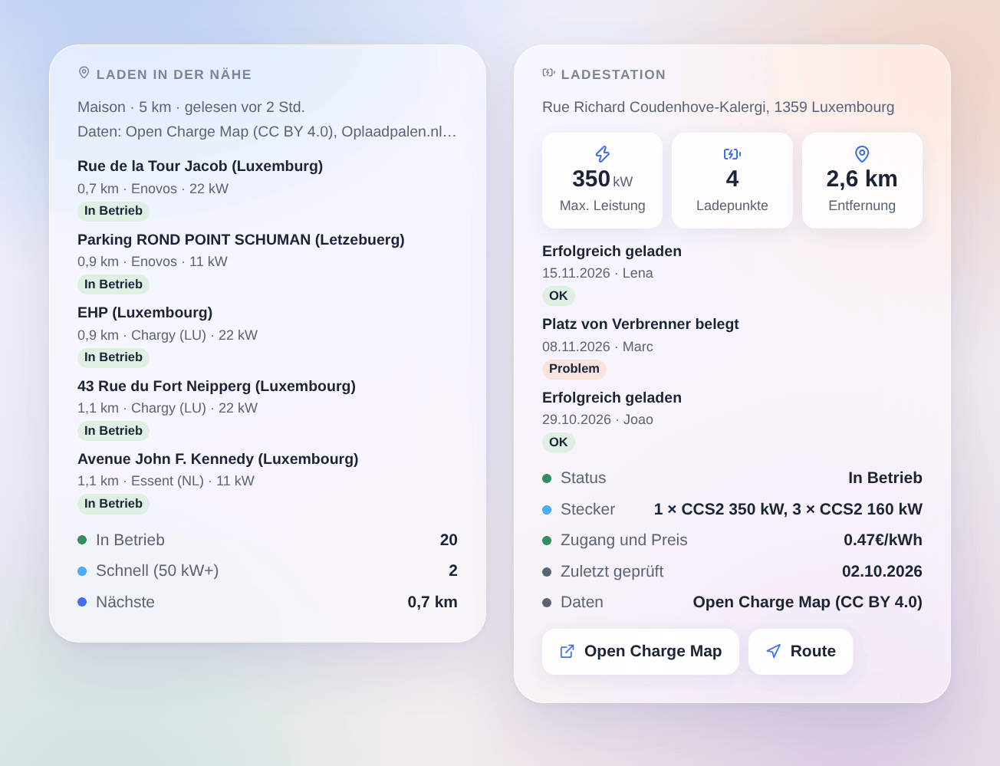

# Open Charge Map

## Überblick

Diese Integration bringt die auf [Open Charge Map](https://openchargemap.org) verzeichneten **öffentlichen Ladestationen** für Elektroautos in Gladys, rund um bis zu drei Orte: ein Haus von Gladys oder eine eingegebene Position.

- ein Gerät pro Ort: die Ladestationen in Betrieb in der Umgebung, wie viele davon schnell sind (50 kW und mehr) und wie weit die nächste entfernt ist;
- ein Gerät pro verfolgter Ladestation: Status, Ladepunkte, Leistung, Stecker, Zugang und Preis sowie der letzte Besuch eines Fahrers;
- Szenen-Auslöser (neue Ladestation in der Nähe, Status einer Ladestation geändert, neuer Besuch) und eine Szenen-Aktion (nächste Ladestation für einen Stecker und eine Leistung finden);
- zwei Dashboard-Widgets: die nächsten Ladestationen und eine einzelne Ladestation.

Open Charge Map ist das offene, weltweite Verzeichnis der Ladestationen, gepflegt von seiner Community und von nationalen Registern. Die Integration liest die offizielle API mit Ihrem kostenlosen persönlichen Schlüssel (Cloud-Transport). Die Live-Belegung einer Station ist nur bekannt, wenn ihr Betreiber sie teilt: Die meisten Stationen zeigen „in Betrieb“, nicht „frei“. Community-Integration, nicht mit Open Charge Map verbunden.

## Voraussetzungen

- Gladys Assistant 5.3.0 oder neuer.
- Ein kostenloser Open-Charge-Map-API-Schlüssel: Melden Sie sich auf [openchargemap.org](https://openchargemap.org/loginprovider/beginlogin) an, öffnen Sie **My profile → My apps**, dann **Register an application**; der Schlüssel wird bei der Anwendung angezeigt.
- Ein auf der Karte verortetes Haus von Gladys (Einstellungen → Häuser) oder eine Position (Breite, Länge).

## Konfiguration

1. Integrationen → Open Charge Map → Konfiguration.
2. Fügen Sie den API-Schlüssel ein, wählen Sie für jeden Ort ein Haus oder geben Sie eine Position ein, stellen Sie die Suche ein und speichern Sie.

| Feld                          | Beschreibung                                                                                             |
| ----------------------------- | -------------------------------------------------------------------------------------------------------- |
| API-Schlüssel                 | Ihr Open-Charge-Map-Schlüssel. Nur an Open Charge Map gesendet.                                          |
| Haus                          | Ein Haus von Gladys: Seine Position ist der Mittelpunkt der Suche.                                       |
| Oder eine Position            | „46.3069, 4.8325“, wie eine Karten-App sie kopiert. Hat Vorrang vor dem Haus.                            |
| Umkreis                       | 1, 2, 5 (Standard), 10, 20 oder 50 km um jeden Ort.                                                      |
| Mindestleistung               | Beliebig (Standard), 7, 11, 22, 50 oder 150 kW, für mindestens einen Stecker.                            |
| Stecker                       | Typ 2, CCS, CHAdeMO, Typ 1, Tesla / NACS, Haushaltssteckdose. Keiner ausgewählt: alle Stecker.           |
| Nur öffentliche Ladestationen | Standardmäßig an: lässt private und Kunden vorbehaltene Stationen weg.                                   |
| Angebotene Ladestationen      | Die 5, 10 (Standard), 20 oder 50 nächsten jedes Ortes, im Tab Entdecken.                                 |
| Open Charge Map gelesen alle  | 1, 3, 6 (Standard), 12 oder 24 Stunden. Eine Anfrage pro Ort, eine weitere für die verfolgten Stationen. |
| Sprache der Texte             | Gerätenamen, Zusammenfassungen und Szenentexte. Automatisch: die Sprache Ihres Dashboards.               |

**Schlüssel und Orte testen** liest Open Charge Map sofort und zeigt für jeden Ort seine Position und die gefundenen Ladestationen.

## Verwendung

### Geräte

Geräte → Open Charge Map → **Entdecken**, dann Ihren Ort („Ladestationen · Zuhause“) und die Ladestationen hinzufügen, die Sie nutzen.

| Gerät       | Funktion                 | Gladys-Typ                                                                                                |
| ----------- | ------------------------ | --------------------------------------------------------------------------------------------------------- |
| Ort         | Ladestationen in Betrieb | Zähler: Stationen in Betrieb im Umkreis, die zur Suche passen                                             |
|             | Schnellladestationen     | Zähler: davon die mit einem Stecker ab 50 kW                                                              |
|             | Nächste Ladestation      | Entfernung (km)                                                                                           |
|             | Zusammenfassung          | Text: „12 Ladestationen in Betrieb im Umkreis von 5 km, davon 3 schnell (50 kW+). Nächste: Lidl, 0,8 km.“ |
| Ladestation | Status                   | Ladestation, Anschlussstatus: Verfügbar (in Betrieb), Belegt, Nicht verfügbar, Fehler                     |
|             | Ladepunkte               | Zähler                                                                                                    |
|             | Details                  | Text: Status, maximale Leistung, Stecker, Zugang und Preis                                                |
|             | Letzter Besuch           | Text: „Erfolgreich geladen, 15.11.2026 (Lena)“ und der Kommentar des Fahrers                              |

„Verfügbar“ zeigt Gladys für eine Station in Betrieb: Open Charge Map weiß, ob eine Station funktioniert, selten, ob sie gerade frei ist. Die Besuche einer Station werden gelesen, sobald Sie ihr Gerät hinzufügen.

### Szenen

Auslöser:

- **Open Charge Map: neue Ladestation in der Nähe**: Eine kürzlich auf Open Charge Map gelistete Station erscheint im Umkreis eines Ortes. Filter: der Ort, schnell (50 kW+) oder nicht.
- **Open Charge Map: Status einer Ladestation geändert**: Eine hinzugefügte Station fällt aus, ist wieder in Betrieb oder ändert ihren Status. Filter: die Station, die Änderung.
- **Open Charge Map: neuer Besuch**: Ein Fahrer meldet einen Ladevorgang, ein Problem oder einen Kommentar zu einer hinzugefügten Station. Filter: die Station, das Ergebnis (Erfolg, Problem, Sonstiges).

Aktion:

- **Open Charge Map: Ladestation finden**: die nächste Ladestation eines Ortes für einen Stecker und eine Mindestleistung, aus der letzten Abfrage: Name, Adresse, Entfernung, Leistung, Stecker, Betreiber, Status, Position, Open-Charge-Map-Seite und ein fertiger Satz.

Beispiele:

- Wenn die Schnellladestation, die ich nutze, ausfällt → eine Nachricht mit `{{triggerEvent.data.summary}}` senden.
- Wenn ein Fahrer ein Problem an meiner üblichen Station meldet → mich vor der Abfahrt benachrichtigen.
- Wenn eine neue Schnellladestation in der Nähe von Zuhause gelistet wird → ihren Namen und ihre Entfernung senden.
- Wenn die Autobatterie schwach ist (mit der Integration Ihres Autos) → die nächste CCS-Station mit 50 kW finden und ihre Zusammenfassung in einer Nachricht senden.

### Widgets

Dashboard → Bearbeiten → **Laden in der Nähe** hinzufügen: Ort, Stecker, Mindestleistung und Anzahl der angezeigten Stationen wählen. Jede Karte zeigt Entfernung, Betreiber, Leistung und Status; sie öffnet die Stecker, die Adresse, Zugang und Preis, den letzten Besuch, die Datenquelle sowie Links zu Open Charge Map und zur Route.

**Ladestation** für eine verfolgte Station hinzufügen: maximale Leistung, Ladepunkte und Entfernung, die letzten Besuche von Fahrern, Status, Stecker, Zugang und Preis, Datum der letzten Prüfung und Datenquelle.

Jedes Widget zeigt den Datenlieferanten der Stationen und seine Lizenz (Open Charge Map Contributors, CC BY 4.0, oder das nationale Register, aus dem die Daten stammen), wie es die Bedingungen von Open Charge Map verlangen.

## Fehlerbehebung

- **„Open Charge Map lehnt den API-Schlüssel ab“**: Kopieren Sie den Schlüssel erneut aus My profile → My apps; ein Schlüssel gehört zu Ihrem Konto.
- **„Ist keine Position“**: Geben Sie die Breite, ein Komma und dann die Länge ein, mit Punkt für die Dezimalstellen: `46.3069, 4.8325`.
- **„Das Haus hat keine Position“**: Verorten Sie das Haus auf der Karte unter Einstellungen → Häuser.
- **Keine oder zu wenige Ladestationen**: Erweitern Sie den Umkreis, wählen Sie Stecker ab oder senken Sie die Mindestleistung; prüfen Sie die Gegend auf der [Open-Charge-Map-Karte](https://map.openchargemap.io).
- **„Open Charge Map bittet um weniger Anfragen“**: Seltener abfragen; die Fair-Use-Regel von Open Charge Map bittet, Anfragen nicht zu wiederholen.
- **Eine Station ist falsch oder fehlt**: Open Charge Map wird von seinen Nutzern gepflegt: Korrigieren Sie sie oder melden Sie einen Besuch auf ihrer Seite (Link im Widget).
- **Logs**: Fügen Sie die Umgebungsvariable `DEBUG=gladys-integration-sdk` hinzu und eröffnen Sie ein Issue auf [GitHub](https://github.com/William-De71/gladys-open-charge-map/issues) mit den Versionen von Gladys und der Integration und den Logs (niemals Ihren API-Schlüssel).
